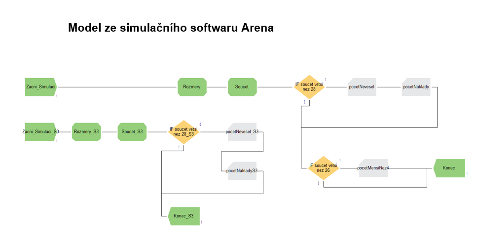

# 🎓 Semestrální práce A – Modelování a simulace

Semestrální práce z předmětu **Modelování a simulace (KST/BMOSI)** na Univerzitě Pardubice, Fakultě elektrotechniky a informatiky.

## 👨‍🎓 Informace o projektu

- **Autor:** Aleš Tlučhoř
- **Univerzita:** Univerzita Pardubice
- **Fakulta:** Fakulta elektrotechniky a informatiky (FEI)
- **Studijní obor:** Informační technologie
- **Ročník:** 3. ročník
- **Semestr:** Zimní
- **Akademický rok:** 2025/2026
- **Předmět:** Modelování a simulace
- **Typ práce:** Semestrální práce A
- **Hodnocení:** 4 body

## 📖 Popis projektu

Cílem práce je pomocí metody **Monte Carlo** simulovat montáž čtyř součástek (S1–S4) do pouzdra luxusních hodinek a vyhodnotit pravděpodobnost neúspěšné montáže.

Simulace se zaměřuje na:
- Pravděpodobnost, že se součástky nevejdou do pouzdra.
- Pravděpodobnost, že volný prostor bude menší než 4 mm.
- Výpočet nákladů na neúspěšné pokusy.
- Porovnání základního a vylepšeného scénáře při úpravě rozměrů součástky S3.

## 🖥️ Simulační model v Areně

Simulační model byl vytvořen v prostředí **Arena Simulation**. Model zachycuje průběh simulace, vyhodnocení rozměrů součástek a rozhodování o úspěšnosti montáže.

## 🛠️ Použité technologie

- **C#** – implementace simulace metodou Monte Carlo.
- **Arena Simulation** – vytvoření simulačního modelu a ověření výsledků.
- **Microsoft Excel** – zpracování a vyhodnocení výsledků.

## 📁 Obsah repozitáře

- `BMOSI_dokumentace.docx` – dokumentace semestrální práce.
- `Program_SemA/` – zdrojový kód simulace v C#.
- `Sem_A/` – simulační model vytvořený v prostředí Arena.
- `Konvergence_Graf_C#.png` – graf konvergence simulace.
- `RustNakladuC#.png` – graf vývoje nákladů.
- `images/` – obrázky použité v README.

## 🎯 Závěr

Simulace ukázala, že i drobná změna rozměrů součástky může mít významný vliv na úspěšnost montáže a celkové výrobní náklady.

Výsledky získané v C# a Areně umožňují porovnat oba simulační přístupy a ověřit jejich vzájemnou shodu.

---

*Univerzita Pardubice – Fakulta elektrotechniky a informatiky*  
*Akademický rok 2025/2026*